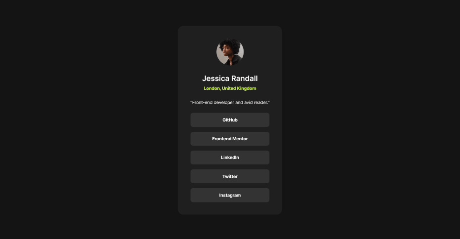
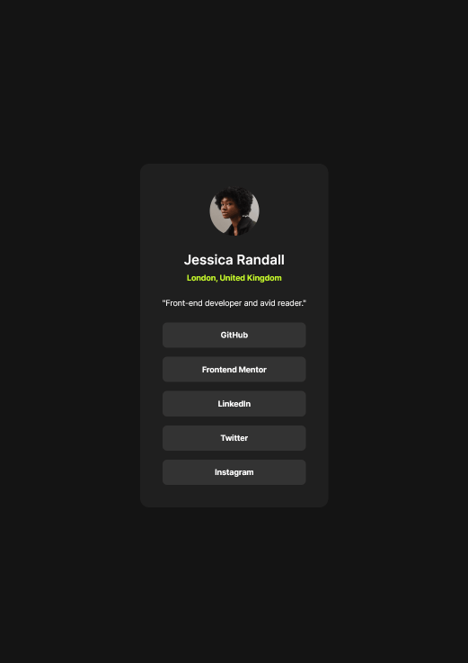
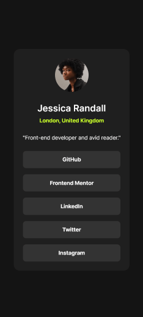

# Frontend Mentor - Social links profile solution

This is a solution to the [Social links profile challenge on Frontend Mentor](https://www.frontendmentor.io/challenges/social-links-profile-UG32l9m6dQ). Frontend Mentor challenges help you improve your coding skills by building realistic projects.

## Table of contents

- [Frontend Mentor - Social links profile solution](#frontend-mentor---social-links-profile-solution)
  - [Table of contents](#table-of-contents)
  - [Overview](#overview)
    - [The challenge](#the-challenge)
    - [Screenshot](#screenshot)
    - [Links](#links)
  - [My process](#my-process)
    - [Built with](#built-with)
    - [What I learned](#what-i-learned)
    - [Continued development](#continued-development)
    - [AI Collaboration](#ai-collaboration)
  - [Author](#author)

## Overview

### The challenge

Users should be able to:

- See hover and focus states for all interactive elements on the page

### Screenshot





### Links

- Solution URL: [https://github.com/AlexRFarnes/social-links-profile](https://github.com/AlexRFarnes/social-links-profile)
- Live Site URL: [https://alexrfarnes.github.io/social-links-profile](https://alexrfarnes.github.io/social-links-profile)

## My process

### Built with

- Semantic HTML5 markup
- CSS custom properties
- Flexbox
- CSS Grid
- Mobile-first workflow

### What I learned

I used @font-face to load Inter from the font file included with the project. That file is a variable font, so one weight range covers the three weights from the style guide: regular (400), semi-bold (600), and bold (700). font-style: normal keeps the text upright.

```css
@font-face {
  font-family: "Inter";
  font-weight: 400 700;
  src: url("./assets/fonts/Inter-VariableFont_slnt,wght.ttf") format("truetype");
  font-style: normal;
}
```

The page layout and the card layout use different tools. CSS Grid on the body creates two rows: the profile card, then the attribution footer. place-items: center centers the card. Flexbox on the card stacks the portrait, name, bio, and links in a column. The list of links is a second flex column, which sets the space between the buttons.

clamp() sets the card width as one range. The card can never be narrower than 272px or wider than 384px. The middle value, 100%, uses whatever space is left inside the page padding. 272px plus 24px of padding on each side of the body equals 320px, so the card still fits on a narrow screen.

```css
inline-size: clamp(272px, 100%, 384px);
```

I first put the padding and the hover background on each li. The link sat inside that padding, so moving the pointer over the edges of a button did not trigger the hover style. Moving the background, padding, and :hover / :focus-visible rules onto the a made the whole button the link.

### Continued development

I want to keep building layouts, and make each one a step more complex than this card. Here, CSS Grid only creates the page: one row for the card and one row for the footer. Flexbox handles the pieces inside the card and the stack of links. On a larger page I want Grid to place the big regions, such as a header and more than one section, and Flexbox to arrange the items inside each region.

I also want to keep using custom properties for colors, type, and spacing. On this project those names live in one :root block and the card reuses them. Next I want a page with more parts, all drawing from that same set of names, so a change to a color or a space updates the whole layout.

### AI Collaboration

I used Cursor while building this project. I asked questions about CSS features I was unsure of, including @font-face, font-style, and clamp(). I also asked it to review my HTML and CSS, and I talked through decisions such as using an article for the card and how narrow the card should be.

I wrote the code myself. The discussions helped me check a choice before I kept it, and the reviews pointed me at things to compare with the design, such as the hover and focus states.

## Author

- Website - [Alex R. Farnes](https://www.alexrfarnes.dev/) (🚧 site in construction)
- Frontend Mentor - [@AlexRFarnes](https://www.frontendmentor.io/profile/AlexRFarnes)
- LinkedIn - [@alexrfarnes](https://www.linkedin.com/in/alexrfarnes)
